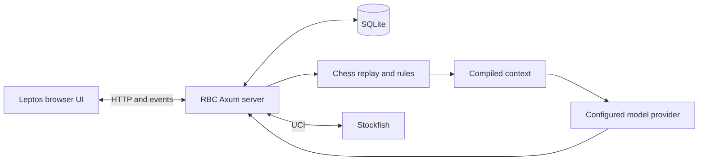

# RustyBrickChess (RBC)

RustyBrickChess is a local chess workstation. Import and search PGNs, analyze
positions with Stockfish, build studies, and play or watch models in the arena.
**KnightLM** is the chess model being trained for RBC. The app can use configured
model providers today, and the trained KnightLM pilot adapter is on the
[roadmap for player integration](apps/rusty-brick-chess/ROADMAP.md#knightlm-model).

Want to help? Start with [Contributing](#documentation-and-contributing).

## Quickstart

### Start RBC

From the repository root, install the frontend build prerequisites once:

```sh
rustup target add wasm32-unknown-unknown
cargo install cargo-leptos --version 0.3.11 --locked
```

| Platform | Build and open RBC | Setup details |
| --- | --- | --- |
| Linux | `./packaging/install.sh`, then open **RustyBrickChess** from the app menu or run `~/.local/bin/rusty-brick-chess --open` | [Linux install guide](docs/app/running.md#linux) |
| Windows | `.\packaging\run-rbc.ps1` from PowerShell | [MSVC setup and verification status](docs/app/running.md#windows-from-source) |

When RBC is running, open [localhost:8090](http://127.0.0.1:8090/). Go to
**Database** to import a PGN or **Analysis** to explore a position. Configure
Stockfish or a model provider in **Settings** when you want those features.

## How it works



RBC serves the WebAssembly UI and API from one local process. SQLite stores
games, studies, sessions, and approvals. Rust handles move legality and replay.
The Assistant compiles inspectable context, and writes that require approval
enter a queue before they can change a board or study. [App reference](apps/rusty-brick-chess/README.md) ·
[MCP and approvals](docs/app/mcp.md)

KnightLM’s research asks whether a fresh, complete state packet improves
reasoning and token efficiency compared with carrying the game history forward.
The text-only SmolVLM LoRA pilot trained and reloaded an adapter on a small
Lichess sample. [Research plan](docs/model/plan.md) · [Training quickstart](model/README.md#lichess-lora-pilot)

## Tooling and how it was made

- **App.** Rust, Axum, Leptos/WASM, and SQLite. The Tauri desktop shell wraps
  the same local server and browser frontend.
- **Chess.** `crates/notation` and `crates/core` normalize records and replay
  positions. Stockfish connects over UCI. The optional [Lichess bot integration](integrations/lichess-bot/README.md)
  also uses the UCI interface.
- **Model.** Python and PEFT run the LoRA pilot. Rust and Burn provide the
  backend experiments, and Python and Mojo check packet parity. [Model tooling](model/README.md)
- **Verification.** Fixture checks exercise the chess and packet contracts.
  Browser tests cover RBC workflows. The [benchmark notes](docs/releases/benchmarks.md)
  record measurements and the conditions they were taken under.

## Documentation and contributing

- [Documentation index](docs/README.md) for app guides, model research, and release evidence.
- [Contributor guide](CONTRIBUTING.md) for setup, checks, and pull requests.
- [Work orders by role](docs/contributors/work/README.md) for ready tasks and pickup commands.
- [Roadmap](apps/rusty-brick-chess/ROADMAP.md) for upcoming app and model work.

## License

RBC is released under the [GNU Affero General Public License, version 3](LICENSE).
See the [sound asset notices](apps/rusty-brick-chess/frontend/assets/sounds/COPYING.txt)
for the bundled Lichess sound themes.

## Credits

- [Project contributors](https://github.com/Quitetall/KnightLM/graphs/contributors)
- [Lichess](https://lichess.org/) for game data and sound themes, including the
  sound work credited to Enigmahack in the bundled notices.
- [Stockfish](https://stockfishchess.org/) for the optional analysis engine.
- [Hugging Face TB](https://huggingface.co/HuggingFaceTB/SmolVLM-500M-Instruct)
  for the SmolVLM checkpoint used in the KnightLM pilot.
