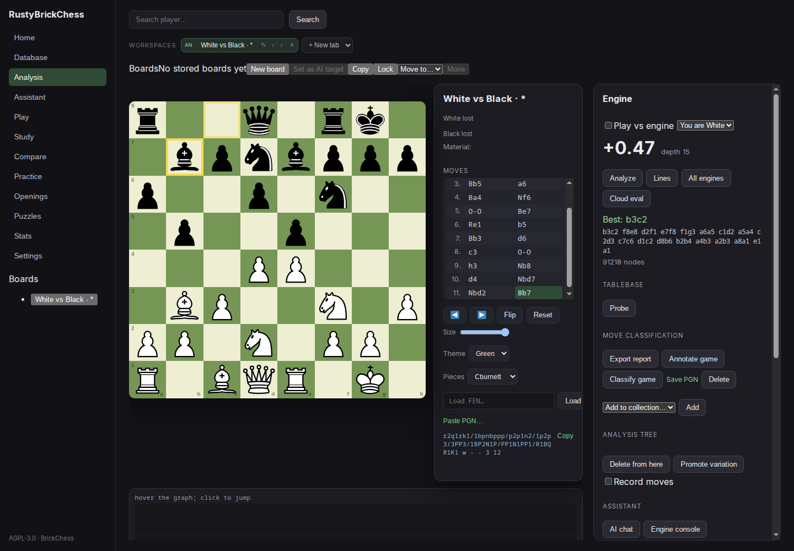
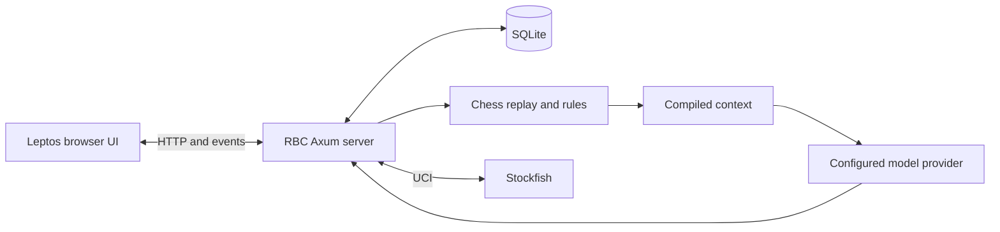
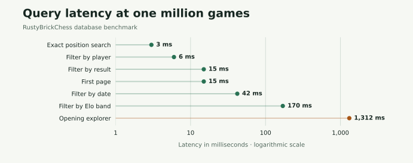

# RustyBrickChess (RBC)

This repository holds two products that meet at one wire contract.

| | RBC (RustyBrickChess) | KnightLM |
| --- | --- | --- |
| What it is | The open-source chess workstation: import and search PGNs, analyze with Stockfish, build studies, play or watch models in the arena. | The ML path: corpus, tokenizer, board encoder, training, evaluation and serving of a chess model. |
| Status | Linux browser app and desktop shell work; Windows and macOS packaging are not qualified. | Research code. Only one short training run (Run 1 short) has happened; there is no strength claim. |
| Start here | [Quickstart](#quickstart), [running RBC](docs/app/running.md) | [KnightLM](#knightlm-the-model-path), [model docs](docs/model/README.md) |
| Needs | Rust, a browser, optional Stockfish | Python 3.11+, optional GPU for training only |

They share no code beyond [`crates/contract`](crates/contract) and the OpenAI-compatible
`/v1/chat/completions` endpoint ([the seam](docs/model/seam.md)). RBC works with no
KnightLM present and with any provider; KnightLM can be served to any client.

New here? Read the [getting started guide](docs/contributors/README.md) for either path.

## Quickstart

### Start RBC

From the repository root, install the frontend build prerequisites once:

```sh
rustup target add wasm32-unknown-unknown
cargo install cargo-leptos --version 0.3.11 --locked
```

| Platform | Build and open RBC | Setup details |
| --- | --- | --- |
| Linux | `./packaging/install.sh`, then open **RustyBrickChess** from the app menu or run `~/.local/bin/rusty-brick-chess --open` | [Linux install guide](docs/app/running.md#linux) |
| Windows | `.\packaging\run-rbc.ps1` from PowerShell | [MSVC setup and verification status](docs/app/running.md#windows-from-source) |

When RBC is running, open [localhost:8090](http://127.0.0.1:8090/). Go to
**Database** to import a PGN or **Analysis** to explore a position. Configure
Stockfish or a model provider in **Settings** when you want those features.



*RBC’s Analysis view after importing a sample Ruy Lopez PGN and running Stockfish at depth 15.*

## How it works



RBC serves the WebAssembly UI and API from one local process. SQLite stores
games, studies, sessions, and approvals. Rust handles move legality and replay.
The Assistant compiles inspectable context, and writes that require approval
enter a queue before they can change a board or study. [App reference](apps/rusty-brick-chess/README.md) ·
[MCP and approvals](docs/app/mcp.md) · [Using a model](docs/app/models.md)

## KnightLM: the model path

KnightLM asks whether a fresh, complete state packet from a deterministic rules
compiler improves chess reasoning and token cost compared with carrying the game
history forward. No arm is presumed to win. What exists today:

- **Compiler and packet.** `crates/core` and `crates/notation` replay games and emit a
  versioned context packet; Python and Mojo check byte parity.
- **Corpus.** The Run 1 pipeline (`model/corpus`) builds audited, leak-checked shards from
  Lichess PGNs, with reasoning variants and a v3 multi-source design. [Corpus v3](docs/model/corpus-v3.md)
- **Representation arms.** Text packet, Chess Graph Text, the `ctok/1` board tokenizer, a
  board encoder, a move-policy head and a perceiver, each specified with CPU-tested reference
  code. [Index and reading order](docs/model/README.md)
- **Training.** A LoRA recipe on SmolVLM-500M through BLUT with a CPU preflight that launches
  nothing; every GPU run needs the owner's go. [Training gate](docs/model/training-gate.md) ·
  [vocabulary](docs/model/training-glossary.md)
- **Evaluation.** A scorecard with separate axes (legality, centipawn loss, tactics, games,
  explanation checks, move head) and deliberately no composite score. [Scorecard](docs/model/scorecard.md)
- **Serving.** `model/serve` exposes `/v1/chat/completions` (play and coach turns, raw or
  constrained decoding), `/v1/move` and `/v1/play`; `knightlm-uci` plays through it in any UCI
  GUI. RBC adds it with Settings > **Add KnightLM server**. [Using a model](docs/app/models.md)
- **Evidence.** Receipts live in the artifact store, not in git; docs cite them by name.

**Status:** only Run 1 short (625 steps, 20,000 rows) has trained. The full 200,000-game
Run 1, every other arm and Qwen-class bases are prepared, not run. Scorecards describe
wiring and short-run behavior, not playing strength.

Try the serving contract without a model or GPU: [fake predictor quickstart](docs/contributors/README.md#run-the-model-server-with-a-fake-predictor).
Model tooling reference: [model/README.md](model/README.md).

## Tooling and how it was made

- **App.** Rust, Axum, Leptos/WASM, and SQLite. The Tauri desktop shell wraps
  the same local server and browser frontend.
- **Chess.** `crates/notation` and `crates/core` normalize records and replay
  positions. Stockfish connects over UCI. The optional [Lichess bot integration](integrations/lichess-bot/README.md)
  also uses the UCI interface.
- **Model.** Python, PyTorch and PEFT for training, evaluation and serving; BLUT
  (`apps/blut-knightlm`) runs the training recipe. Rust and Burn provide backend
  experiments, and Python and Mojo check packet parity. [Model tooling](model/README.md)

### Verification

`make check` runs the Rust workspace, the Python model tests and the contract and layering checks; CI also runs the torch-dependent model tests, the desktop shell and the browser suites. See [Contributing](CONTRIBUTING.md#ci-jobs). Browser tests cover RBC workflows.



*Recorded release-build query timings from one 3.6 GB SQLite database on tmpfs, populated with 1,000,000 seeded synthetic games of 8–67 plies. Position search and the opening explorer were measured after 1.e4. The horizontal axis is logarithmic.* [Benchmark notes](docs/releases/benchmarks.md#the-database)

## Documentation and contributing

- [Documentation index](docs/README.md) for app guides, model research, and release evidence.
- [Getting started](docs/contributors/README.md) for setup on a fresh clone, for the RBC and KnightLM paths.
- [Contributor guide](CONTRIBUTING.md) for the branch and pull request flow, CI and claiming work.
- [Work orders by role](docs/contributors/work/README.md) for ready tasks and pickup commands; open
  work is also mirrored to [GitHub Issues](https://github.com/Quitetall/KnightLM/issues).
- [Roadmap](apps/rusty-brick-chess/ROADMAP.md) for upcoming app and model work.

## License

RBC is released under the [GNU Affero General Public License, version 3](LICENSE).
See the [sound asset notices](apps/rusty-brick-chess/frontend/assets/sounds/COPYING.txt)
for the bundled Lichess sound themes.

## Credits

- [Project contributors](https://github.com/Quitetall/KnightLM/graphs/contributors)
- [Lichess](https://lichess.org/) for game data and sound themes, including the
  sound work credited to Enigmahack in the bundled notices.
- [Stockfish](https://stockfishchess.org/) for the optional analysis engine.
- [Hugging Face TB](https://huggingface.co/HuggingFaceTB/SmolVLM-500M-Instruct)
  for the SmolVLM checkpoint used in the KnightLM pilot.
